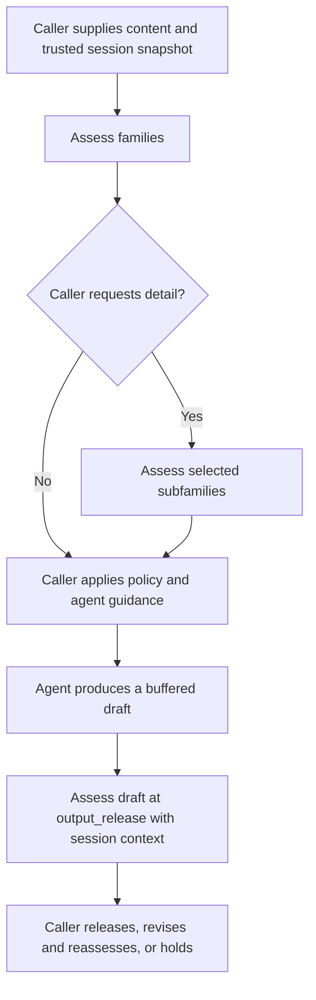

# chat-safety

Typed, provider-neutral risk assessments for conversational applications.

Give `chat-safety` your content, conversation context, and risk definitions. It returns structured scores for risk families and subfamilies, assessed at message or session scope. Your application decides how to use that evidence: guide an agent, request more detail, review a tool action, or assess a draft before releasing it.

**The primary API returns evidence, not permission to act.** It does not run tools, modify prompts, rewrite responses, block messages, or store conversations. Those controls belong to the application.

The package is alpha (`0.1.0a0`) and requires Python 3.10 or later. Its example criteria and thresholds are synthetic; they are not a calibrated production policy.

## Install

Install from a source checkout:

```bash
git clone https://github.com/BahulamAI/chat-safety.git
cd chat-safety
python -m venv .venv
source .venv/bin/activate
python -m pip install -e '.[jev]'
```

Use `pip install -e .` for the provider-neutral core without the optional HTTP dependency, or `pip install -e '.[dev]'` for development and tests. Pin a reviewed commit when integrating a source checkout into a deployed application.

## Quick start without credentials

From the repository root:

```bash
PYTHONPATH=src python examples/family_nudge.py
```

This offline example uses invented scores to demonstrate message and session assessment, configurable top-N reporting, an explicit subfamily follow-up, and application-owned guidance. It makes no network requests.

The [example source](examples/family_nudge.py) also shows how to implement a custom evaluator. An evaluator implements `async evaluate(request, questions)` and returns a `RiskEvaluation` containing a `RiskScore` for every requested question, an evaluator name, and a model version.

## Concepts

| Concept | Meaning |
| --- | --- |
| Stage | Where the content occurs: `input`, `tool_proposal`, `tool_result`, or `output_release` |
| Scope | What is assessed: the latest `message`, or the supplied `session` trajectory |
| Family | An application-defined risk area, such as `health` or `privacy` |
| Subfamily | A more specific criterion within a family, such as `unauthorized_disclosure` |
| Registry | Versioned family definitions, message/session questions, context limits, and reporting defaults |
| Application policy | Thresholds and actions chosen by the caller; separate from the primary assessment API |

A session is a scope, not a stage. An assistant draft can be assessed at `output_release` with both message and session scope. Sharing and export are not assessment stages; applications handle their access and privacy rules separately.

## Assess with Jev or a compatible gateway

The included `JevRiskEvaluator` sends Decisions API requests. Pass the endpoint, model, and credential explicitly from trusted application configuration. A gateway must implement the same request/response contract; a generic chat-completions endpoint is not sufficient.

The following example runs from the repository root after installation. Set `SAFETY_DECISIONS_ENDPOINT`, `SAFETY_MODEL`, and `SAFETY_API_KEY` through your application's configuration and secret management. These names are conventions for this example, not environment variables automatically read by the library.

```python
import asyncio
import json
import os

from chat_safety import (
    AssessmentInput,
    AssessmentScope,
    AssessmentStatus,
    RecentTurn,
    RiskAssessor,
    Stage,
    load_risk_registry,
)
from chat_safety.adapters.jev_risk import JevRiskEvaluator


async def main():
    registry = load_risk_registry("examples/risk-registry.json")
    evaluator = JevRiskEvaluator(
        endpoint=os.environ["SAFETY_DECISIONS_ENDPOINT"],
        model=os.environ["SAFETY_MODEL"],
        api_key=os.environ["SAFETY_API_KEY"],
        timeout_seconds=8.0,
    )
    assessor = RiskAssessor(registry, evaluator)
    request = AssessmentInput(
        request_id="event-2",
        registry_version=registry.version,
        stage=Stage.INPUT,
        content="How should I compare the evidence?",
        assessment_scopes=(AssessmentScope.MESSAGE, AssessmentScope.SESSION),
        session_ref="conversation-1",
        session_revision=1,
        recent_turns=(
            RecentTurn("user", "Explain how clinical studies compare treatments."),
            RecentTurn("assistant", "We can compare study design and limitations."),
        ),
    )
    result = await assessor.assess_families(request, top_k_families=3)
    if result.status is not AssessmentStatus.COMPLETE:
        # An unavailable assessment is not evidence of low risk.
        # Your application chooses its retry, review, or fallback behavior.
        print(result.error_code)
        return
    print(json.dumps(result.to_dict(), indent=2))


if __name__ == "__main__":
    asyncio.run(main())
```

For direct provider access, the adapter defaults to endpoint `https://openrouter.ai/api/alpha/decisions` and model `typesafe/jev-1.14`. You may override both as above. Calls send the supplied text and context to the configured endpoint. The library does not read deployment variables, discover credentials, or fall back from a gateway to a direct provider.

## Define your risk registry

Start with [examples/risk-registry.json](examples/risk-registry.json). It contains four illustrative families: `health`, `privacy`, `system_integrity`, and `financial_harm`. It is intentionally small, not a universal safety taxonomy.

The registry uses schema `chat-safety.risks/1` and contains:

- `version`: the caller's version identifier for the definition set.
- `reporting.top_k_families`: a positive integer, defaulting to `3`.
- `families`: a map of family IDs to descriptions, questions, and optional subfamilies.
- `limits`: optional context bounds; see [ContextLimits](src/chat_safety/context.py).

Every family and subfamily requires both `message` and `session` questions. Each question has `instructions`, `true_criteria`, and `false_criteria`. For example, a question can distinguish unapproved disclosure from authorized handling or redaction. Family and subfamily IDs must match `[a-z][a-z0-9_]{0,63}`. New IDs do not require a package release.

**Jev receives the selected question instructions and criteria, plus the content/context snapshot—not the entire registry or your application policy file.** The adapter maps questions to opaque IDs and maps returned probabilities back to the family, subfamily, and scope. Descriptions are metadata; question wording supplies the model-facing meaning.

The loader rejects malformed definitions and duplicate JSON keys. Version and evaluate changes to your questions: a familiar family name does not itself define what the model should measure.

## Scores, top-N reporting, and subfamily expansion

`assess_families` evaluates **all configured families** for every requested scope. `top_k_families` controls reporting, not which families are evaluated:

- `scores` contains every assessed family/scope score.
- `top_families` contains up to N ranked families **per scope**.
- Requesting more families than the registry contains returns all available families.
- Scores are independent criterion probabilities in `[0, 1]`; they do not sum to one.
- A low-scoring family may still appear in the top N. Ranking is not a declaration of harm or proof of user intent.

Sorting is deterministic for a given set of returned scores. Model inference is not guaranteed to produce identical scores on repeated calls.

Subfamilies require an explicit second call. The caller chooses parents using its own thresholds or other policy:

```python
# Place inside main(), after a complete family assessment in the example above.
# These thresholds are illustrative, not calibrated recommendations.
expand_at = {"health": 0.60, "privacy": 0.60}
selected = tuple(sorted({
    score.family_id
    for score in result.scores
    if score.family_id in expand_at
    and score.probability >= expand_at[score.family_id]
}))
if selected:
    detail = await assessor.assess_subfamilies(request, family_ids=selected)
    if detail.status is AssessmentStatus.COMPLETE:
        assert detail.input_digest == result.input_digest
        assert detail.registry_digest == result.registry_digest
        # Apply trusted application policy to detail.scores.
```

Inspect all scores when checking thresholds, not only `top_families`. Selected parents must exist and have children. The follow-up evaluates their children across the requested scopes; it does not replace the broad family scores. There are no automatic follow-up calls, nudges, or rewrites.

## Session assessment and persistence

Message scope evaluates the latest content, with supplied history available for interpretation. Session scope evaluates what the provided sequence collectively enables or is moving toward, including the assistant's contributions. A benign individual message can therefore coexist with a concerning session score.

For session assessments:

1. Load a trusted conversation snapshot in your application.
2. Supply `session_ref` and `session_revision` together, and request `AssessmentScope.SESSION` explicitly. The default scope is message only.
3. Include relevant `recent_turns` and, if needed, a server-produced `safety_summary`. Supported turn roles are `user`, `assistant`, `tool_proposal`, and `tool_result`.
4. Persist the returned evidence and the actual application outcome against that revision. Check the revision before using results from asynchronous or concurrent assessments.
5. Reassess when the content, draft, or history changes.

The library does not fetch history, build summaries, maintain a global user risk score, or calculate longitudinal trends. A session score describes the supplied snapshot; it is not an average of earlier message scores. Applications can compare compatible assessments over time, but must account for changes in questions, models, scopes, and context coverage.

Default bounds include 12,000 characters of latest content, eight recent turns, 3,000 characters per recent turn, and a 2,000-character summary. Oversize input raises `ContextTooLarge` before evaluation; the library never silently truncates it. Configure bounds for your use case and retain coverage metadata when selecting or summarizing history. Missing history cannot be assessed.

The optional legacy `SessionTracker` described below is separate from `RiskAssessor`; it is not an automatic persistence layer for family assessments.

## Application flow: guidance, tools, and output release

A possible integration looks like this. Each application-owned step is implemented by the caller:



Use trusted application templates for agent guidance. A nudge is a mitigation attempt, not proof that the final answer followed it. If your application must assess text before users see it, buffer the draft and perform an output assessment before streaming. Rewritten drafts need fresh assessments. The package itself provides neither a streaming buffer nor a rewrite loop.

For tools, assess a bounded proposal or result at the corresponding stage. Independently enforce identity, permissions, argument validation, resource scope, and any required user approval before execution. A low risk score never authorizes a tool call. Tool results and retrieved text remain untrusted content.

With the Jev adapter, family questions for all requested scopes are bundled into one HTTP request. A subfamily assessment adds another request; assessing an output draft adds another. Reducing top N alone does not reduce the number of family questions. Your application owns latency budgets, scheduling, retry limits, and behavior when an assessment is unavailable.

## Result contract and failures

`RiskAssessment.to_dict()` returns a JSON-compatible record with schema `chat-safety.assessment/1`:

| Fields | Purpose |
| --- | --- |
| `request_id`, `stage`, `level` | Identify the event and family/subfamily assessment |
| `registry_version`, `registry_digest`, `input_digest` | Identify the definitions and assessed snapshot |
| `session_ref`, `session_revision`, `assessment_scopes` | Associate evidence with the correct conversation state |
| `status`, `error_code` | Distinguish complete evidence from an unavailable evaluation |
| `scores`, `top_families`, `assessed_family_ids`, `top_k_families` | Carry scores and reporting metadata |
| `evaluator`, `model_version` | Record the evaluator and returned model snapshot when available |

Provider errors and invalid, duplicate, or missing score coverage return `status="unavailable"`, `error_code="EVALUATION_UNAVAILABLE"`, and empty scores. They do not produce zero-risk scores or an allow/refuse decision. Invalid caller arguments, registry mismatches, and context-limit violations raise before the provider call.

Serialized assessments exclude raw content, but still contain caller-provided identifiers and risk evidence. Apply your own access controls and retention policy. Keep credentials out of assessed content and logs; a content fingerprint is not a substitute for privacy controls.

## Optional legacy action-policy API

The package also retains `SafetyGate` for applications that explicitly want category scores mapped to actions. `RiskAssessor` does not invoke it.

| API | Configuration | Result |
| --- | --- | --- |
| `RiskAssessor` | Dynamic `RiskRegistry` families and subfamilies | Evidence only |
| `SafetyGate` | Fixed `Category` enum and versioned `PolicyBundle` | Recommended/effective `allow`, `constrain`, `review`, or `refuse` |

Use `load_policy_json` with [runtime-policy.json](examples/runtime-policy.json) for the legacy gate. The policy defines required/optional categories, questions, and stage-specific message/session thresholds. `shadow` mode records recommendations; `enforce` mode makes the policy action effective in the returned decision. The caller still enforces that decision. These are legacy API modes, not modes of `RiskAssessor`.

`SessionTracker` supports bounded legacy session state, outcomes, and serialization. `SessionStore` is an interface: applications implement durable storage and atomic compare-and-swap on revisions. See [caller_session.py](examples/caller_session.py) for a complete offline example and [minimal.py](examples/minimal.py) for a basic gate.

## Testing and evaluation

Run the offline suite and examples from the repository root:

```bash
PYTHONPATH=src python -m unittest discover -s tests -v
PYTHONPATH=src python examples/family_nudge.py
PYTHONPATH=src python examples/minimal.py
PYTHONPATH=src python examples/caller_session.py
PYTHONPATH=src python -m chat_safety.eval_cli \
  --policy examples/synthetic-policy.json \
  --cases examples/synthetic-cases.jsonl \
  --list-decisions --fail-on-mismatch
```

Install the `dev` extra to include HTTP adapter tests. The replay CLI evaluates the **legacy action policy** against recorded synthetic probabilities. It reports aggregate metrics and case IDs without printing case text. Passing replay proves fixture routing and fallback behavior, not model accuracy or real-world safety.

An opt-in live Jev test is also available:

```bash
# Supply CHAT_SAFETY_OPENROUTER_API_KEY securely in your environment first.
PYTHONPATH=src python examples/live_jev_eval.py --run-live
```

This script uses the legacy evaluator and sends bundled synthetic cases directly to OpenRouter; it can incur charges. It requires the explicit flag, a key, and synthetic markers. It prints scores, decisions, and model metadata rather than prompts or credentials. It is not the gateway-configured example above.

For application evaluation, keep a labeled corpus covering benign research, ambiguous intent, cumulative assistance, tool actions, and output responses. Separate calibration and held-out test scenarios. Measure false positives, missed risks, helpfulness, guidance adherence, provider failures, and latency separately. Record registry/question versions, model snapshots, context coverage, and actual outcomes. Example thresholds and a successful connectivity test do not establish production calibration.

## Source map

| Module | Responsibility |
| --- | --- |
| [assessment.py](src/chat_safety/assessment.py) | Evidence contracts, validation, family and subfamily assessment |
| [registry.py](src/chat_safety/registry.py) | Strict JSON registry loader |
| [adapters/jev_risk.py](src/chat_safety/adapters/jev_risk.py) | Jev adapter for the family API |
| [context.py](src/chat_safety/context.py) | Context bounds |
| [questions.py](src/chat_safety/questions.py) | Provider-neutral binary criteria |
| [models.py](src/chat_safety/models.py) | Stages, scopes, and legacy action contracts |
| [config.py](src/chat_safety/config.py), [policy.py](src/chat_safety/policy.py), [engine.py](src/chat_safety/engine.py) | Legacy policy loading and action composition |
| [session.py](src/chat_safety/session.py) | Legacy session state and storage interface |
| [evaluation.py](src/chat_safety/evaluation.py) | Legacy offline evaluation metrics |

## Contributing

Include offline tests for behavior changes and examples for public API changes. Keep credentials, private conversations, and deployment-specific configuration out of contributions. Describe changes to question meaning or score interpretation so downstream callers can evaluate them before adoption.

## License

[MIT](LICENSE).
